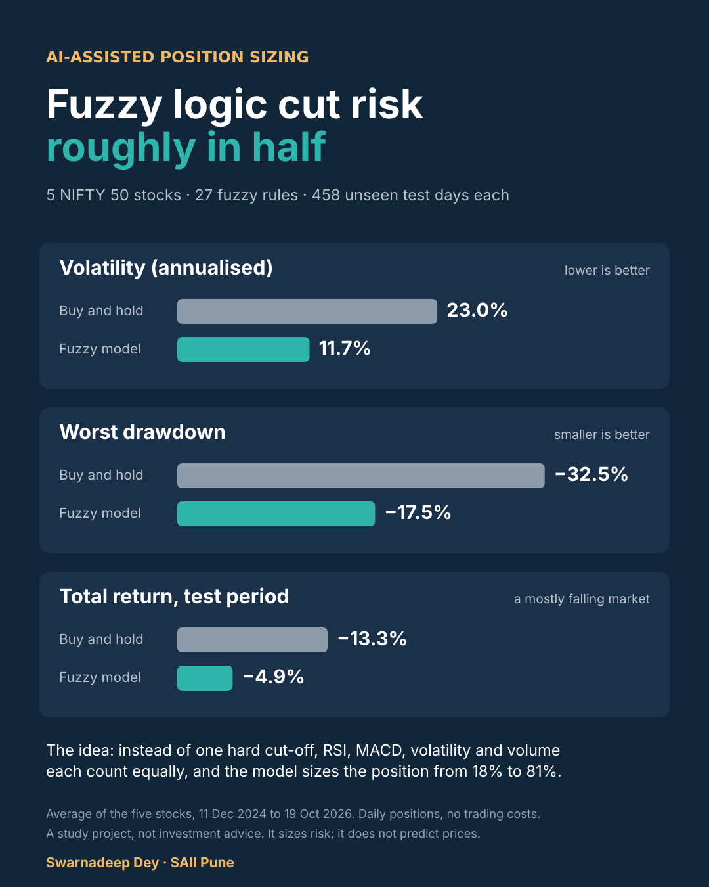

# AI-Assisted Position Sizing with Fuzzy Logic

A 27-rule Mamdani fuzzy model that sizes a stock position (18% to 81%) from four technical indicators with equal importance: **RSI, MACD histogram, 20-day volatility and relative volume**. Built for the CA-3 mini project in Foundational Mathematics for AI, SAII Pune.



## What it does
- Turns each indicator into low / medium / high fuzzy sets, using one shared set of boundaries (pooled quartiles of a 12-month calibration year).
- Combines them in three stages with 27 rules and defuzzifies with the centroid method to give a position size.
- Compares against a crisp fixed-threshold rule and buy and hold.

## Data and test
Five NIFTY 50 stocks: HDFC Bank, Hindustan Unilever, TCS, Reliance, Tata Steel (daily prices from Yahoo Finance, CSVs included). Calibration: first 12 months. Test: 458 unseen trading days per stock (11 Dec 2024 to 19 Oct 2026).

## Results (average of the five stocks, no trading costs)
| | Volatility (ann.) | Worst drawdown | Total return |
|---|---|---|---|
| Buy and hold | 23.0% | -32.5% | -13.3% |
| Crisp rule | 12.2% | -17.7% | -5.6% |
| Fuzzy (Mamdani) | 11.7% | -17.5% | -4.9% |

Fuzzy beat the crisp rule on volatility in 5 of 5 stocks and drawdown in 2 of 5. Mean position sizes: HDFC Bank 51.2, HUL 45.8, TCS 43.6, Reliance 48.9, Tata Steel 44.5.

**Limits:** the test period was mostly falling, costs are ignored, and the model sizes risk; it does not predict prices. Study project, not investment advice.

## Run it
```
pip install -r requirements.txt
python step5_run.py        # model on the test days
python step6_sens.py       # sensitivity analysis
python step7_backtest.py   # buy and hold vs crisp vs fuzzy
python make_figs_1.py && python make_fig3.py && python make_figs_2.py && python make_figs_3.py   # figures
python verify_all.py       # 7 correctness checks
```
`fuzzy_lib.py` holds the indicators and `fuzzy_model.py` holds the membership functions and rules. `download_data.py` re-downloads the CSVs.

Author: Swarnadeep Dey ([GitHub](https://github.com/Swarnadeep-dey))
